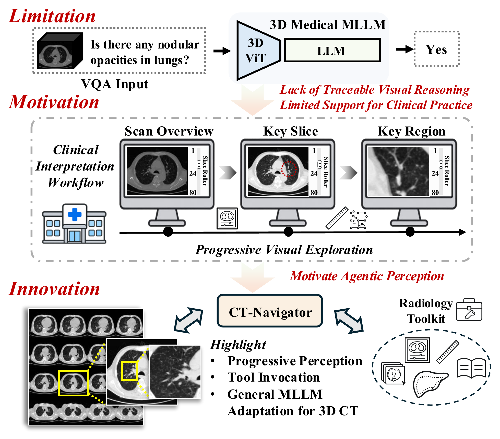

# CT-Navigator: Towards Interpretable and Generalizable CT Understanding through Agentic Perception and Tool-Invocation

  

This is an official PyTorch implementation for *CT-Navigator: Towards Interpretable and Generalizable CT Understanding through Agentic Perception and Tool-Invocation*.

Contact: [yibingfu@u.nus.edu](mailto:yibingfu@u.nus.edu) (Yibing Fu)

Share us a ⭐ if this repository does help.

## Updates

Code, pretrained model, and benchmark will be released.

## License

This repository is licensed under the Apache License 2.0.
